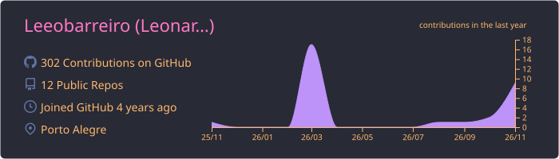
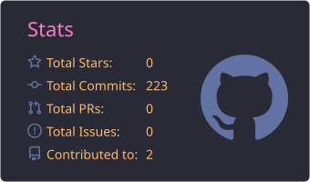
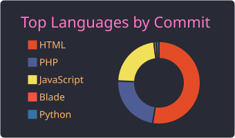

  

  
  

## Sobre mim

Sou desenvolvedor em Porto Alegre e trabalho principalmente com **PHP/Laravel** e **Moodle**: plugins, sincronização de dados entre plataformas e integrações com serviços como Mailchimp e WordPress. Fora isso, gosto de automatizar tarefas chatas com **Python** e de criar ferramentas em **JavaScript** para resolver problemas meus, como um treinador de xadrez com Stockfish.

- 🔭 Agora: **TrainerChess**, um app para aprender xadrez sem precisar saber notação
- 🌱 Estudando: arquitetura de aplicações Laravel e front-end moderno
- 💬 Pode falar comigo sobre: Moodle, Laravel, automação de processos

## Stack

  

## Projetos em destaque

| Projeto | O que é | Stack |
|---|---|---|
| ♟️ [**TrainerChess**](https://github.com/Leeobarreiro/TrainerChess) | Treinador de xadrez para iniciantes: Stockfish explica a melhor jogada em palavras e setas, com ~3.900 variantes de abertura, exercícios gerados a partir dos seus erros e análise das suas partidas do chess.com | JavaScript, Stockfish |
| 🛒 [**Mini ERP**](https://github.com/Leeobarreiro/Mini-erp) | Sistema de pedidos com produtos e variações, carrinho, cupons, frete, busca de CEP (ViaCEP) e e-mail de confirmação | Laravel, MySQL, Bootstrap |
| 🧾 [**Automação de Notas Fiscais**](https://github.com/Leeobarreiro/automacao_notafiscal) | Lê XMLs de DANFE e gera uma planilha Excel só com os dados que o setor de compras precisa | Python, pandas |
| 🔄 [**Sincroniza Plugin**](https://github.com/Leeobarreiro/Sincroniza-Plugin) | Plugin Moodle que sincroniza cursos, progresso, coortes e conclusões dos alunos com o WordPress via cron | PHP, Moodle |
| ✉️ [**Mailchimp para Moodle**](https://github.com/Leeobarreiro/Mail-chimp) | Plugin que conecta o Moodle ao Mailchimp | PHP, Moodle |
| 🌐 [**Portfólio 3D**](https://github.com/Leeobarreiro/Portifolio-Three.js-main) | Portfólio animado em Three.js | JavaScript, Three.js |

## Estatísticas

  

  
  

  

